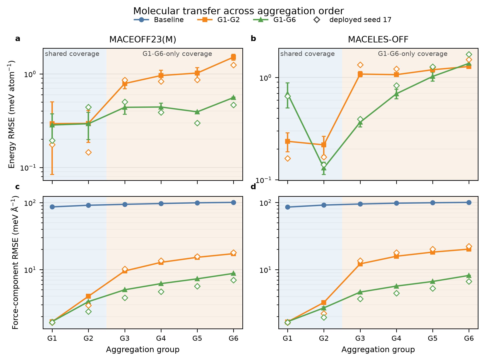
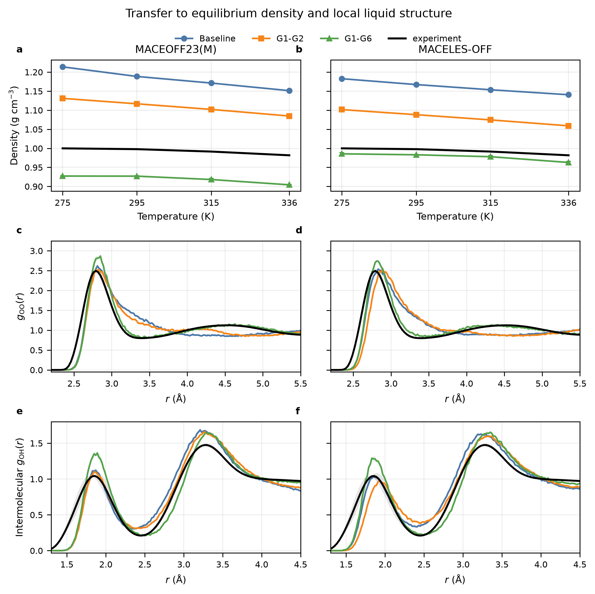
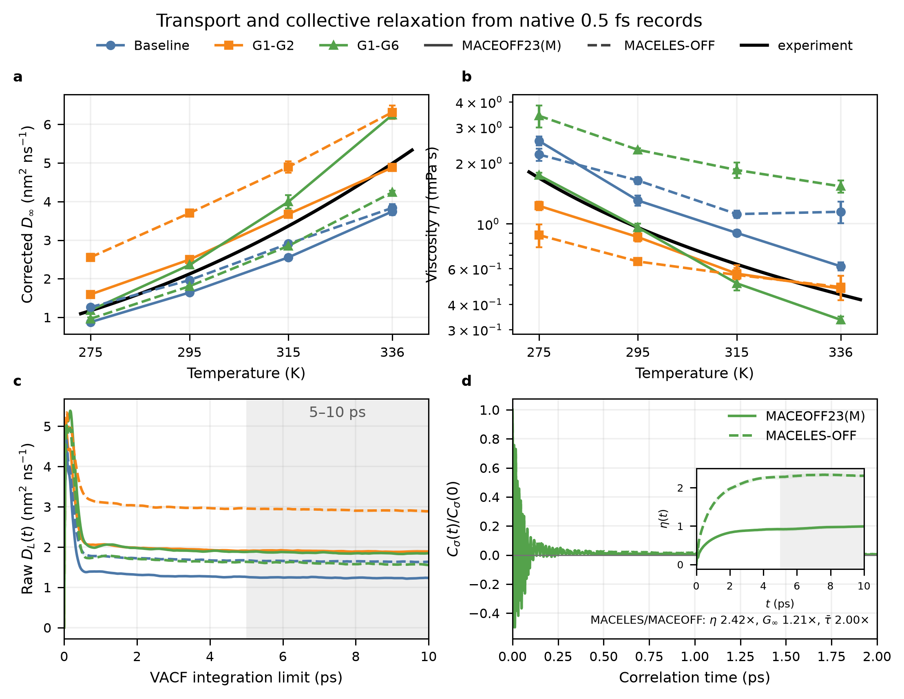
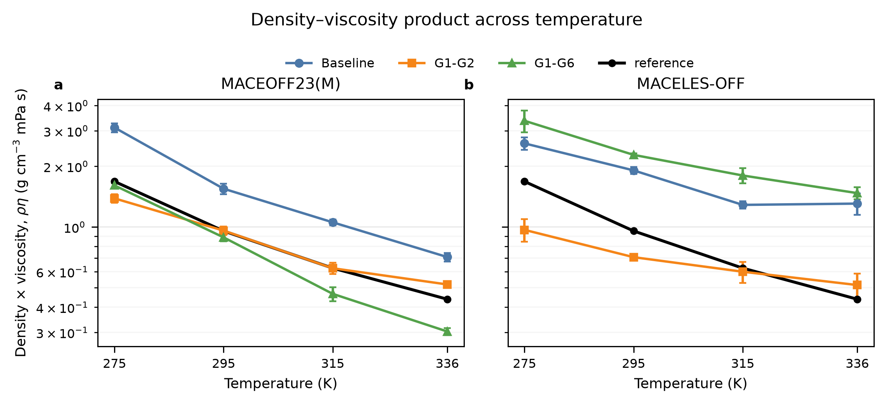

> Archived 700 ps workshop snapshot. These bulk results are superseded. [Use the final release](../../README.md). Commands below run from the repository root.

# Paper figures

These are review-ready layouts for the three-stage manuscript story:
molecular transfer, equilibrium liquid structure, and transport. PNG and PDF versions are available in [`paper/figures`](../../paper/figures); compact
source data are in [`model_training/data`](../../model_training/data) and [`md_simulations/data/published_results`](../../md_simulations/data/published_results).

Tables 1--2 and draft interpretation are in
[`RESULTS.md`](RESULTS.md), with
machine-readable table values in [`model_training/data`](../../model_training/data).

## Figure 1 — Molecular transfer



Energy panels show G1-G2 and G1-G6 only because the released zero-shot foundations
do not share a defensible absolute-energy reference with the new quantum labels.
Force panels include Baseline. Lines and error bars are the mean and sample SD across
three training seeds; open diamonds identify seed 17, which was deployed in MD.
All points use common parent-held-out validation families, not the locked test
set. G1--G2 occur in both adaptation datasets; only G1-G6 contains G3--G6.

[PDF](../../paper/figures/figure1_molecular_transfer.pdf) ·
[source summary](../../model_training/data/force_energy_results.csv) ·
[seed-17 values](../../model_training/data/force_energy_seed17.csv)

## Figure 2 — Equilibrium density and structure



Density is the paired velocity-seed replica mean with sample SD over the final
500--1,000 ps of each completed 1 ns NPT trajectory. RDFs are simulation results
at 295 K with replica-SD bands; the Soper reference is at 298 K. Covalent O--H
pairs are excluded from the intermolecular O--H RDF. Density is compared with
IAPWS-95. These are the completed full-length NPT aggregates; the earlier
mixed-end issue concerned an old NVT initialization branch, not these averages.

[PDF](../../paper/figures/figure2_equilibrium_structure.pdf) ·
[density data](../../md_simulations/data/published_results/density.csv) ·
[RDF data](../../md_simulations/data/published_results/rdf_295K.csv) ·
[Soper reference](../../md_simulations/data/published_results/soper_298K.csv)

## Figure 3 — Transport and collective relaxation



All transport estimates use the strict MACELES-OFF / Baseline replacement, the common 700 ps
NVT prefix, and the native 0.5 fs velocity/stress records. State error bars and
curve bands are SEM over three paired velocity-seed replicas. Reported values
average the running integrals over 5--10 ps. Corrected diffusion is not
independent of viscosity:

$$
D_\infty=D_L+\frac{k_{\mathrm B}T\xi}{6\pi\eta L}.
$$

Panel c therefore shows the raw finite-cell running integral. Panel d compares
MACEOFF23(M) / G1-G6 and MACELES-OFF / G1-G6 at 295 K; its inset shows the corresponding finite-window
viscosity integrals. The displayed LES/OFF ratios use the same 5--10 ps
estimator: $\eta=2.42$, $G_\infty=1.21$, and
$\bar\tau_\sigma=2.00$. These support a finite-window stress-relaxation
interpretation, not a claim of thermodynamic-limit convergence.

[PDF](../../paper/figures/figure3_transport_relaxation.pdf) ·
[state estimates](../../md_simulations/data/published_results/transport_0p5fs.csv) ·
[native-cadence curves](../../md_simulations/data/published_results/transport_curves_295K_0p5fs.npz) ·
[stress decomposition](../../md_simulations/data/published_results/stress_decomposition_295K.csv)

## Supplement — Density times viscosity



This derived view multiplies the Figure 2 density mean by the Figure 3
viscosity mean at each model/temperature state. Its uncertainty propagates the
reported density and viscosity SEMs as independent inputs because the compact
tables do not retain their cross-covariance. The black curve is IAPWS density
times experimental viscosity.

[PDF](../../paper/figures/density_times_viscosity.pdf) ·
[source table](../../md_simulations/data/published_results/density_times_viscosity.csv)

## Rebuild

```bash
python paper/build_figures.py
```

The plotting script reads only the committed compact inputs; raw trajectories
are not required.
